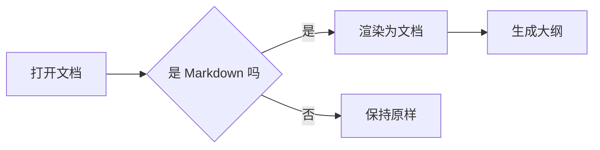
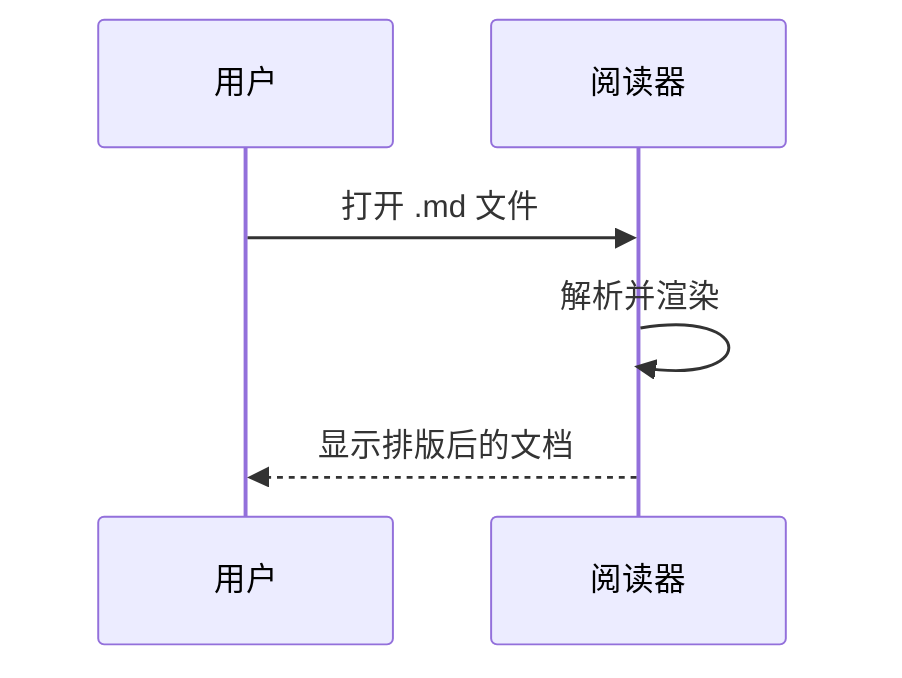

# Markdown 语法速查

一份用来演示渲染效果的示例文档，涵盖常用的 Markdown 语法。

> 提示：左侧大纲会自动跟随滚动高亮当前章节，点击条目可跳转。

---

## 一、行内格式

常用行内标记一览：

| 写法 | 效果 |
| --- | --- |
| `**加粗**` | **加粗** |
| `*斜体*` | *斜体* |
| `~~删除线~~` | ~~删除线~~ |
| `` `行内代码` `` | `行内代码` |
| `[链接](https://example.com)` | [链接](https://example.com) |

也可以组合使用：**加粗里的 *斜体***、代码里的 `const answer = 42`。

---

## 二、列表

### 无序列表

- 第一项
- 第二项
  - 嵌套一层
  - 再嵌套一层
    - 还能更深
- 第三项

### 有序列表

1. 准备材料
2. 开始制作
   1. 第一步的子步骤
   2. 第二步的子步骤
3. 完成收尾

### 任务列表

- [x] 已经完成的事项
- [x] 另一件已完成的事
- [ ] 待办事项
- [ ] 还没开始的事

> 任务列表的复选框是只读的——阅读器不会修改你的文件。

---

## 三、代码块

支持语法高亮，鼠标悬停时右上角会出现复制按钮。

**JavaScript**

```javascript
async function fetchDocument(url) {
  const response = await fetch(url);
  if (!response.ok) throw new Error(`请求失败：${response.status}`);
  return response.text();
}
```

**Python**

```python
from dataclasses import dataclass


@dataclass
class Document:
    title: str
    words: int

    def reading_time(self, wpm: int = 250) -> float:
        """按每分钟阅读词数估算耗时（分钟）"""
        return round(self.words / wpm, 1)
```

**SQL**

```sql
SELECT
    category,
    COUNT(*) AS total,
    AVG(rating) AS avg_rating
FROM reviews
WHERE created_at >= '2026-01-01'
GROUP BY category
HAVING COUNT(*) > 10
ORDER BY total DESC;
```

**Shell**

```bash
#!/usr/bin/env bash
set -euo pipefail

for file in ./docs/*.md; do
  echo "处理 $file"
done
```

---

## 四、引用

> 单层引用。
>
> > 嵌套引用，常用于回复或补充说明。

> **带标题的引用**
>
> 引用块里同样可以使用**加粗**、`代码`、列表等行内格式。
>
> - 列表项一
> - 列表项二

---

## 五、表格

左对齐、居中、右对齐三种对齐方式：

| 左对齐 | 居中 | 右对齐 |
| :--- | :---: | ---: |
| 内容 | 内容 | 内容 |
| 较长的一段文字 | 短 | 1,234 |
| 另一行 | 中 | 56 |

---

## 六、数学公式

行内公式：质能方程 $E = mc^2$，勾股定理 $a^2 + b^2 = c^2$。

块级公式：

$$
\int_{-\infty}^{\infty} e^{-x^2} \, dx = \sqrt{\pi}
$$

求和与分数：

$$
S_n = \sum_{k=1}^{n} \frac{1}{k^2} \xrightarrow{n \to \infty} \frac{\pi^2}{6}
$$

---

## 七、Mermaid 图表

流程图：



时序图：



---

## 八、图片

点击任意图片可全屏放大。放大后支持滚轮缩放、按住拖动平移，
多张图之间可以用左右按钮或 `←` `→` 方向键切换。


> 三张图放在一起，方便演示「上一张 / 下一张」。
> 切换后缩放会重置回原始大小。

---

## 九、分隔线与脚注

三个或更多的短横线会渲染成分隔线：

---

脚注写作 `[^1]`，会出现在文档末尾[^1]。

[^1]: 这是脚注的内容，点击正文里的角标可以跳转到这里。

---

## 十、长文档的表现

### 三级标题

这一节用来演示三层以上的大纲结构，方便观察侧边栏的层级缩进。

#### 四级标题

再深一层。

##### 五级标题

还能更深。

###### 六级标题

Markdown 支持到六级标题。

### 另一个三级标题

同级标题之间会并列显示在大纲里。

---

*本文档为演示用途，内容均为示例。*
