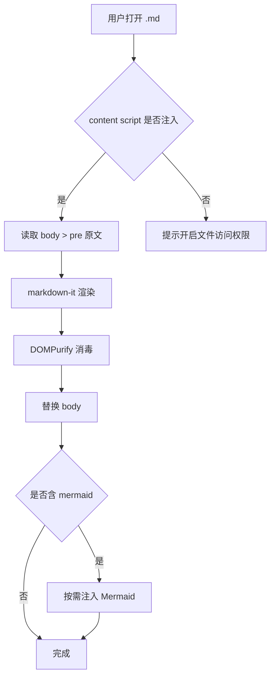
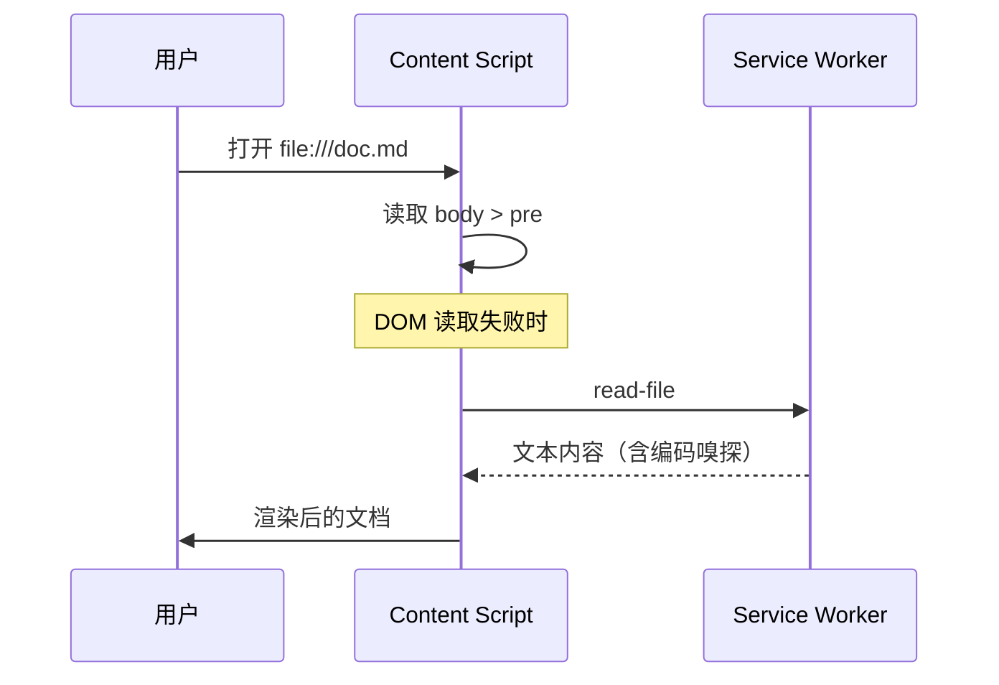
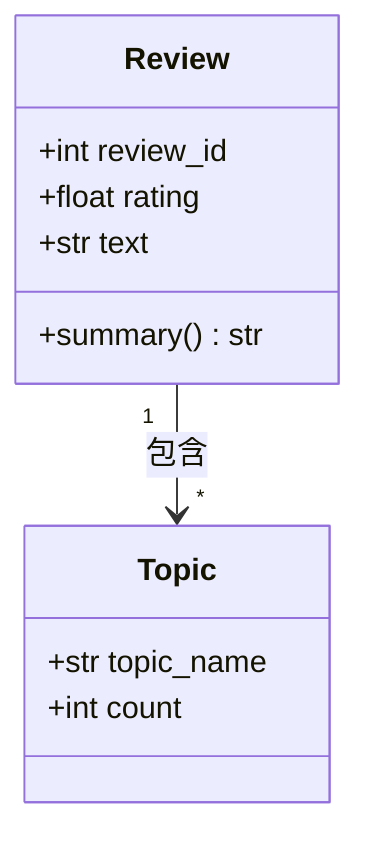
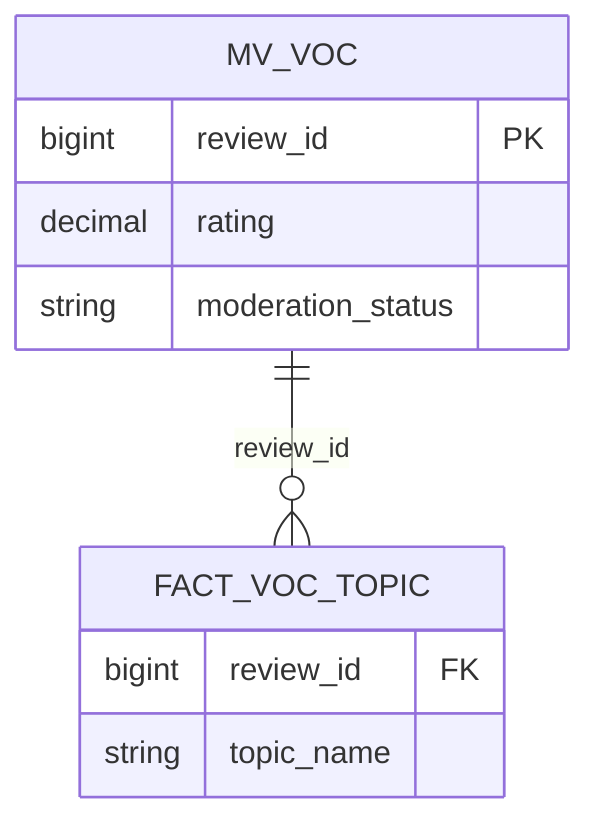
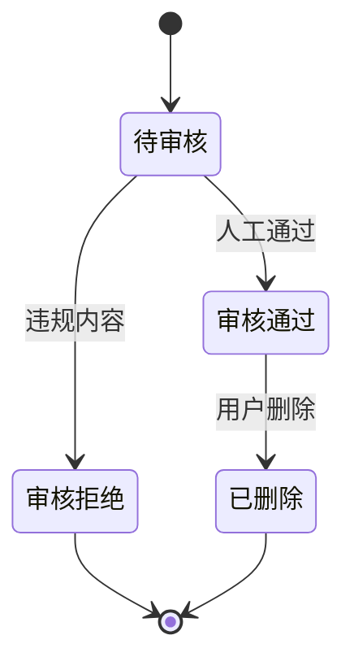
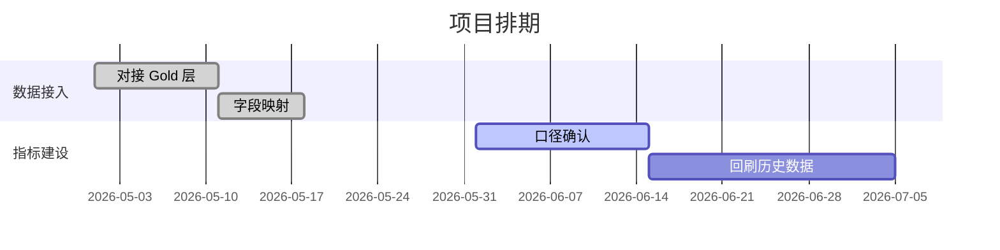
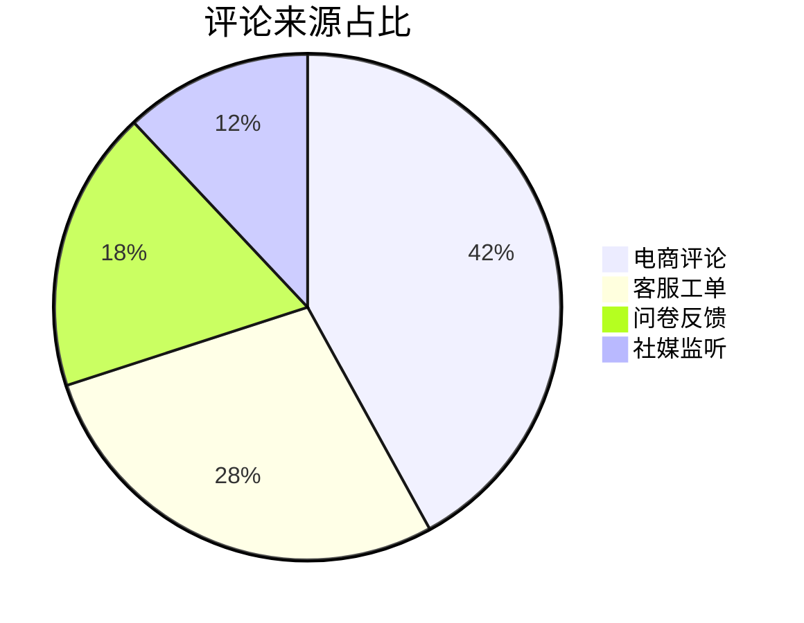
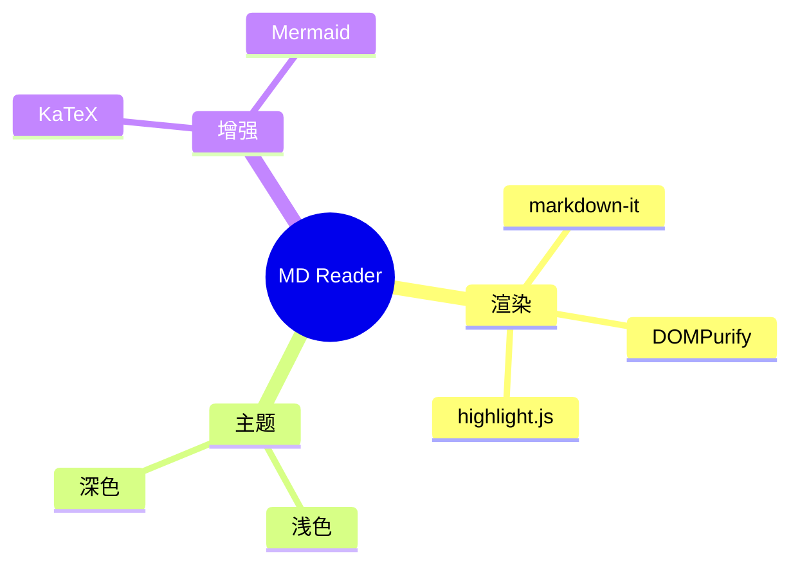

# Mermaid 图表测试

> ⚠️ Mermaid 打包后有约 5 MB，只在页面真的出现 ` ```mermaid ` 时才注入，
> 所以**首次打开本文件会有 1 秒左右的延迟**，图表随后才出现。
> 这是预期行为。

## 流程图



## 时序图



## 类图



## ER 图



## 状态图



## 甘特图



## 饼图



## 思维导图



## 故意写错的图表（应该降级为原始代码而不是崩溃）

```mermaid
graph TD
  A --> --> B
  这不是合法的 mermaid 语法
```

上面这段渲染失败后，应当保留原始代码文本并带上提示色，页面不应白屏。

## 图表与其它内容混排

图表前面有文字。


图表后面也有文字，说明块级元素的间距是否正常。

| 图表类型 | 是否支持 |
| --- | --- |
| flowchart | ✅ |
| sequence | ✅ |
| class / ER / state | ✅ |
| gantt / pie / mindmap | ✅ |
