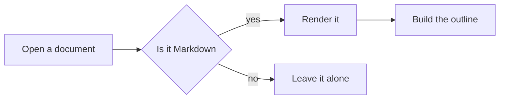
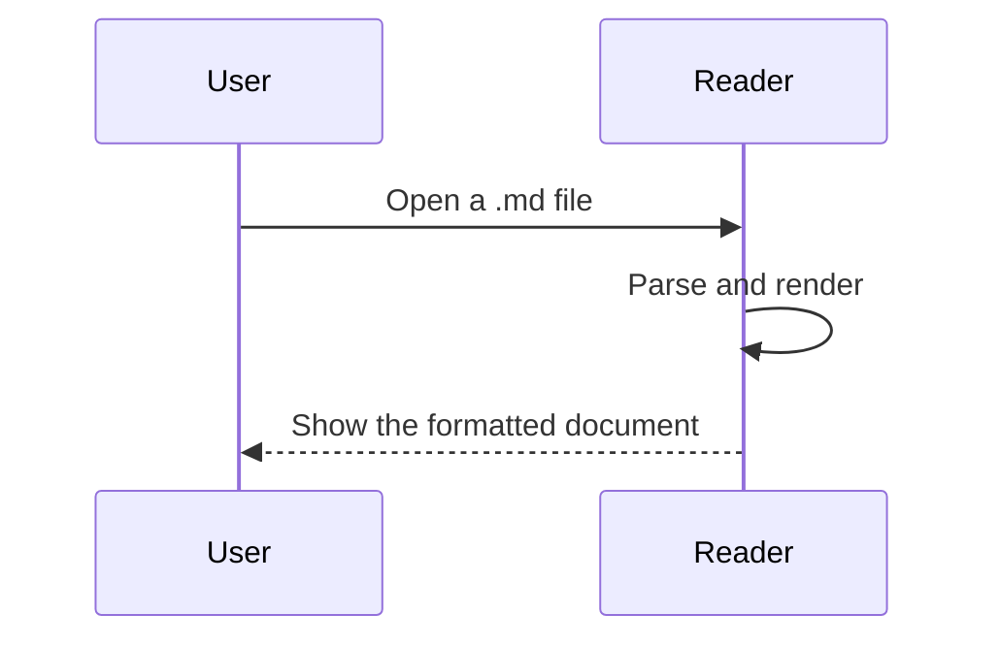

# Markdown Syntax Cheat Sheet

A sample document for demonstrating the rendering. It covers the syntax you are most likely to use.

> Tip: the outline on the left highlights the current section as you scroll. Click an entry to jump to it.

---

## 1. Inline Formatting

Common inline markers at a glance:

| Syntax | Result |
| --- | --- |
| `**bold**` | **bold** |
| `*italic*` | *italic* |
| `~~strikethrough~~` | ~~strikethrough~~ |
| `` `inline code` `` | `inline code` |
| `[link](https://example.com)` | [link](https://example.com) |

They combine as well: **bold with *italic* inside**, and code such as `const answer = 42`.

---

## 2. Lists

### Unordered

- First item
- Second item
  - Nested one level
  - Nested another level
    - Deeper still
- Third item

### Ordered

1. Gather the materials
2. Start building
   1. A substep of the first
   2. Another substep
3. Wrap up

### Task list

- [x] Something already done
- [x] Another finished item
- [ ] A to-do item
- [ ] Not started yet

> The checkboxes in task lists are read-only — the reader never modifies your files.

---

## 3. Code Blocks

Syntax highlighting is on, and a copy button appears when you hover a block.

**JavaScript**

```javascript
async function fetchDocument(url) {
  const response = await fetch(url);
  if (!response.ok) throw new Error(`Request failed: ${response.status}`);
  return response.text();
}
```

**Python**

```python
from dataclasses import dataclass


@dataclass
class Document:
    title: str
    words: int

    def reading_time(self, wpm: int = 250) -> float:
        """Estimate reading time in minutes"""
        return round(self.words / wpm, 1)
```

**SQL**

```sql
SELECT
    category,
    COUNT(*) AS total,
    AVG(rating) AS avg_rating
FROM reviews
WHERE created_at >= '2026-01-01'
GROUP BY category
HAVING COUNT(*) > 10
ORDER BY total DESC;
```

**Shell**

```bash
#!/usr/bin/env bash
set -euo pipefail

for file in ./docs/*.md; do
  echo "processing $file"
done
```

---

## 4. Blockquotes

> A single-level quote.
>
> > A nested quote, handy for replies or asides.

> **A quote with a heading**
>
> Inline formatting works inside quotes too — **bold**, `code`, and lists.
>
> - First point
> - Second point

---

## 5. Tables

The three alignment options, side by side:

| Left | Center | Right |
| :--- | :---: | ---: |
| Content | Content | Content |
| A somewhat longer cell | Short | 1,234 |
| Another row | Mid | 56 |

---

## 6. Math

Inline: mass–energy equivalence $E = mc^2$, and the Pythagorean theorem $a^2 + b^2 = c^2$.

Display:

$$
\int_{-\infty}^{\infty} e^{-x^2} \, dx = \sqrt{\pi}
$$

Sums and fractions:

$$
S_n = \sum_{k=1}^{n} \frac{1}{k^2} \xrightarrow{n \to \infty} \frac{\pi^2}{6}
$$

---

## 7. Mermaid Diagrams

A flowchart:



A sequence diagram:



---

## 8. Images

Click any image to open it full screen. Once open, scroll to zoom, drag to pan,
and switch between images with the arrow buttons or the `←` `→` keys.


> Three images in a row, to demonstrate previous / next.
> Switching resets the zoom back to the original size.

---

## 9. Dividers and Footnotes

Three or more dashes render as a horizontal rule:

---

A footnote is written as `[^1]` and appears at the end of the document[^1].

[^1]: This is the footnote body. Clicking the marker in the text jumps here.

---

## 10. Long Documents

### A third-level heading

This section exists to demonstrate outline depth — handy for checking the indentation in the sidebar.

#### A fourth-level heading

One level deeper.

##### A fifth-level heading

Deeper still.

###### A sixth-level heading

Markdown supports headings down to level six.

### Another third-level heading

Headings at the same level appear side by side in the outline.

---

*This document is for demonstration only. All content is sample text.*
